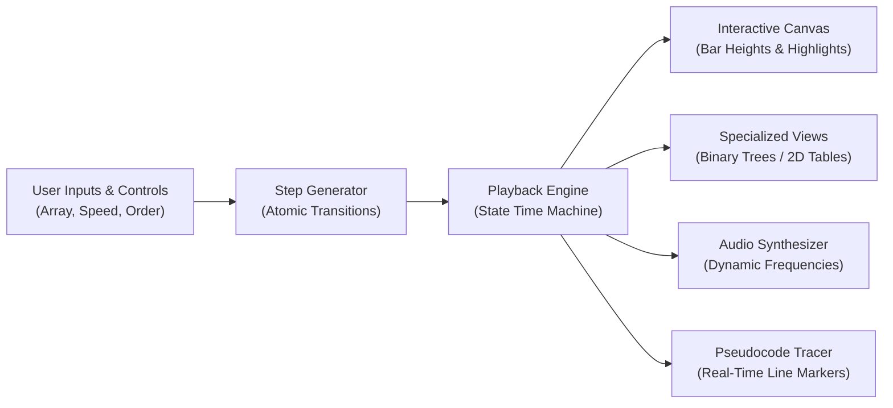

<div align="center">

# ⚡ Dalgo — Interactive Algorithm Visualizer & Learning Hub

<p align="center">
  <b>A state-of-the-art interactive algorithm visualization and computer science learning suite.</b><br>
  Explore step-by-step executions, color-coded state transitions, real-time audio synthesis, synchronized pseudocode tracking, and multi-language code snippets.
</p>

[](https://debasisswain28022-maker.github.io/Dalgo-/)

<br>

[](https://react.dev/)
[](https://vitejs.dev/)
[](https://tailwindcss.com/)
[](https://debasisswain28022-maker.github.io/Dalgo-/#/algorithms)
[](https://debasisswain28022-maker.github.io/Dalgo-/#/visualizer)
[](https://debasisswain28022-maker.github.io/Dalgo-/#/greedy-dp)
[](test/algorithms.test.mjs)
[](LICENSE)

<br>

### 🧭 Quick Navigation

[**🚀 Live Demo**](#-live-demo) •
[**⚡ Divide & Conquer**](#-divide-and-conquer-algorithms-12) •
[**🔮 Exotic Sorting**](#-exotic--specialized-sorting-algorithms-9) •
[**📚 Standard Sorting**](#-standard-sorting-foundations-10) •
[**💎 Greedy & DP**](#-greedy-algorithms--dynamic-programming-suite) •
[**⌨️ Shortcuts**](#-interactive-controls--keyboard-shortcuts) •
[**📸 Diagram Export**](#-publication-ready-diagram--storyboard-exports) •
[**🧩 Quiz Challenge**](#-interactive-knowledge-quiz) •
[**🏗️ Architecture**](#️-project-architecture) •
[**💻 Quickstart**](#-getting-started-locally)

---

</div>

## 🌐 Live Demo

> **Experience the live web platform:**  
> 🔗 **[https://debasisswain28022-maker.github.io/Dalgo-/](https://debasisswain28022-maker.github.io/Dalgo-/)**

```
 ┌────────────────────────────────────────────────────────────────────────────────────────────────────────┐
 │  [ Bubble ]  [ Selection ]  [ Insertion ]  [ Merge ]  [ Quick ]  [ Heap ]  [ ✨ + More (21 Algos) ]    │
 ├────────────────────────────────────────────────────────────────────────────────────────────────────────┤
 │  ▶ Play    ⏸ Pause    ⏮ Step Back    ⏭ Step Forward    ↺ Reset    🔀 Shuffle    ↕ Asc/Desc Toggle     │
 └────────────────────────────────────────────────────────────────────────────────────────────────────────┘
```

---

## 🔬 How Dalgo Works (Interactive Execution Engine)



---

## 🧮 Algorithm Catalog & Complexity Matrix

<details open>
<summary><h3>⚡ 1. Divide and Conquer Sorting Algorithms (12)</h3></summary>
<p><i>Accessed in the Visualizer via the <b>Divide & Conquer</b> tab in the <b>+ More</b> menu or the Algorithm dropdown.</i></p>

| Algorithm | Difficulty | Best | Average | Worst | Auxiliary Space | Stable | In-Place | Key Algorithmic Mechanism |
| :--- | :---: | :---: | :---: | :---: | :---: | :---: | :---: | :--- |
| **[Merge Sort](https://debasisswain28022-maker.github.io/Dalgo-/)** | 🟡 Medium | $O(n \log n)$ | $O(n \log n)$ | $O(n \log n)$ | $O(n)$ | 🟢 Yes | 🔴 No | Multi-level divide & conquer splitting into singletons with stable 2-way merges. |
| **[Quick Sort](https://debasisswain28022-maker.github.io/Dalgo-/)** | 🟡 Medium | $O(n \log n)$ | $O(n \log n)$ | $O(n^2)$ | $O(\log n)$ | 🔴 No | 🟢 Yes | Hoare / Lomuto partitioning dividing array around a pivot; recurses on partitions. |
| **[Dual-Pivot Quick Sort](https://debasisswain28022-maker.github.io/Dalgo-/)** | 🔴 Hard | $O(n \log n)$ | $O(n \log n)$ | $O(n^2)$ | $O(\log n)$ | 🔴 No | 🟢 Yes | Yaroslavskiy partitioning dividing the array into 3 regions ($< P_1$, $P_1..P_2$, $> P_2$). Standard in Java. |
| **[Three-Way Quick Sort](https://debasisswain28022-maker.github.io/Dalgo-/)** | 🔴 Hard | $O(n)$ | $O(n \log n)$ | $O(n^2)$ | $O(\log n)$ | 🔴 No | 🟢 Yes | Dijkstra's Dutch National Flag partitioning ($< P$, $== P$, $> P$); linear time on many duplicates. |
| **[Heap Sort](https://debasisswain28022-maker.github.io/Dalgo-/)** | 🟡 Medium | $O(n \log n)$ | $O(n \log n)$ | $O(n \log n)$ | $O(1)$ | 🔴 No | 🟢 Yes | Builds Max-Heap (asc) / Min-Heap (desc) with interactive binary tree visualizer and root extractions. |
| **[Intro Sort (Introsort)](https://debasisswain28022-maker.github.io/Dalgo-/)** | 🔴 Hard | $O(n \log n)$ | $O(n \log n)$ | $O(n \log n)$ | $O(\log n)$ | 🔴 No | 🟢 Yes | Musser's hybrid: begins with Quick Sort, switches to Heap Sort on depth limit ($2\lfloor\log_2 n\rfloor$), Insertion Sort on small runs. Standard in C++ STL. |
| **[Tim Sort](https://debasisswain28022-maker.github.io/Dalgo-/)** | 🔴 Hard | $O(n)$ | $O(n \log n)$ | $O(n \log n)$ | $O(n)$ | 🟢 Yes | 🔴 No | Detects natural ascending/descending runs, extends short runs via Insertion Sort to `minRun`, and merges runs stably. Standard in Python & V8. |
| **[Block Merge Sort](https://debasisswain28022-maker.github.io/Dalgo-/)** | 🔴 Hard | $O(n \log n)$ | $O(n \log n)$ | $O(n \log n)$ | $O(1)$ | 🟢 Yes | 🟢 Yes | Divides array into $\sqrt{n}$ blocks, sorts blocks, and merges using cyclic internal buffer rotations in $O(1)$ space. |
| **[In-Place Merge Sort](https://debasisswain28022-maker.github.io/Dalgo-/)** | 🔴 Hard | $O(n \log n)$ | $O(n \log^2 n)$ | $O(n \log^2 n)$ | $O(1)$ | 🟢 Yes | 🟢 Yes | Divide-and-conquer merging in-place via element rotation shifts without auxiliary array allocations. |
| **[Patience Sort](https://debasisswain28022-maker.github.io/Dalgo-/)** | 🔴 Hard | $O(n)$ | $O(n \log n)$ | $O(n \log n)$ | $O(n)$ | 🔴 No | 🔴 No | Deals cards into sorted piles via binary search (computes LIS length); extracts output via $k$-way heap merge. |
| **[Smooth Sort](https://debasisswain28022-maker.github.io/Dalgo-/)** | 🔴 Hard | $O(n)$ | $O(n \log n)$ | $O(n \log n)$ | $O(1)$ | 🔴 No | 🟢 Yes | Dijkstra's adaptive Leonardo heap sort ($L(k)$ numbers); reaches $O(n)$ on pre-sorted data with $O(1)$ space. |
| **[Tournament Sort](https://debasisswain28022-maker.github.io/Dalgo-/)** | 🔴 Hard | $O(n \log n)$ | $O(n \log n)$ | $O(n \log n)$ | $O(n)$ | 🔴 No | 🔴 No | Knockout binary tournament tree: champions advance to root, winner extracted, and ancestor path replayed in $O(\log n)$. |

</details>

<details>
<summary><h3>🔮 2. Exotic & Specialized Sorting Algorithms (9)</h3></summary>
<p><i>Accessed in the Visualizer via the <b>Exotic & Distribution</b> tab in the <b>+ More</b> menu or the Algorithm dropdown.</i></p>

| Algorithm | Difficulty | Best | Average | Worst | Auxiliary Space | Stable | In-Place | Key Algorithmic Mechanism |
| :--- | :---: | :---: | :---: | :---: | :---: | :---: | :---: | :--- |
| **[Exchange Sort](https://debasisswain28022-maker.github.io/Dalgo-/)** | 🟢 Easy | $O(n^2)$ | $O(n^2)$ | $O(n^2)$ | $O(1)$ | 🔴 No | 🟢 Yes | Compares current index with all subsequent indices, immediately swapping out-of-order pairs. |
| **[Gnome Sort](https://debasisswain28022-maker.github.io/Dalgo-/)** | 🟢 Easy | $O(n)$ | $O(n^2)$ | $O(n^2)$ | $O(1)$ | 🟢 Yes | 🟢 Yes | Single loop traversal stepping forward on order and backward on swap like a garden gnome. |
| **[Cocktail Shaker Sort](https://debasisswain28022-maker.github.io/Dalgo-/)** | 🟡 Medium | $O(n)$ | $O(n^2)$ | $O(n^2)$ | $O(1)$ | 🟢 Yes | 🟢 Yes | Bidirectional Bubble Sort alternating forward (max) and backward (min) passes to eliminate turtles. |
| **[Comb Sort](https://debasisswain28022-maker.github.io/Dalgo-/)** | 🟡 Medium | $O(n \log n)$ | $O(n^2 / 2^p)$ | $O(n^2)$ | $O(1)$ | 🔴 No | 🟢 Yes | Diminishing gap (shrink factor 1.3, Rule of 11) eliminating small values near the end of the array. |
| **[Odd-Even Sort](https://debasisswain28022-maker.github.io/Dalgo-/)** | 🟡 Medium | $O(n)$ | $O(n^2)$ | $O(n^2)$ | $O(1)$ | 🟢 Yes | 🟢 Yes | Brick Sort alternating parallel-friendly odd-index and even-index adjacent comparison phases. |
| **[Cycle Sort](https://debasisswain28022-maker.github.io/Dalgo-/)** | 🟡 Medium | $O(n^2)$ | $O(n^2)$ | $O(n^2)$ | $O(1)$ | 🔴 No | 🟢 Yes | Permutation cycle factoring; mathematically optimal minimum array memory writes ($\le n - 1$). |
| **[Strand Sort](https://debasisswain28022-maker.github.io/Dalgo-/)** | 🟡 Medium | $O(n)$ | $O(n^2)$ | $O(n^2)$ | $O(n)$ | 🟢 Yes | 🔴 No | Repeatedly pulls sorted strands from remaining items and merges into accumulated output. |
| **[Binary Insertion Sort](https://debasisswain28022-maker.github.io/Dalgo-/)** | 🟡 Medium | $O(n \log n)$ | $O(n^2)$ | $O(n^2)$ | $O(1)$ | 🟢 Yes | 🟢 Yes | Binary searches the sorted partition in $O(\log n)$ comparisons before shifting elements into position. |
| **[Library Sort](https://debasisswain28022-maker.github.io/Dalgo-/)** | 🔴 Hard | $O(n \log n)$ | $O(n \log n)$ | $O(n^2)$ | $O(n)$ | 🔴 No | 🔴 No | Gapped Insertion Sort with interleaved shelf gaps and periodic rebalancing for $O(1)$ amortized shifts. |

</details>

<details>
<summary><h3>📚 3. Standard Sorting Foundations (10)</h3></summary>
<p><i>The foundational sorting algorithms accessible across the standard button bar and main catalog.</i></p>

| Algorithm | Category | Best | Average | Worst | Auxiliary Space | Stable | In-Place | Notable Feature |
| :--- | :--- | :---: | :---: | :---: | :---: | :---: | :---: | :--- |
| **[Bubble Sort](https://debasisswain28022-maker.github.io/Dalgo-/)** | Beginner | $O(n)$ | $O(n^2)$ | $O(n^2)$ | $O(1)$ | 🟢 Yes | 🟢 Yes | Early-exit flag on zero swaps; classic educational model. |
| **[Selection Sort](https://debasisswain28022-maker.github.io/Dalgo-/)** | Beginner | $O(n^2)$ | $O(n^2)$ | $O(n^2)$ | $O(1)$ | 🔴 No | 🟢 Yes | Minimum write operations ($O(n)$ swaps total). |
| **[Insertion Sort](https://debasisswain28022-maker.github.io/Dalgo-/)** | Beginner | $O(n)$ | $O(n^2)$ | $O(n^2)$ | $O(1)$ | 🟢 Yes | 🟢 Yes | Near-instant on small or already-sorted datasets. |
| **[Merge Sort](https://debasisswain28022-maker.github.io/Dalgo-/)** | Intermediate | $O(n \log n)$ | $O(n \log n)$ | $O(n \log n)$ | $O(n)$ | 🟢 Yes | 🔴 No | Stable recursive divide-and-conquer with tree breakdown view. |
| **[Quick Sort](https://debasisswain28022-maker.github.io/Dalgo-/)** | Intermediate | $O(n \log n)$ | $O(n \log n)$ | $O(n^2)$ | $O(\log n)$ | 🔴 No | 🟢 Yes | In-place cache-friendly partitioning with recursion node states. |
| **[Heap Sort](https://debasisswain28022-maker.github.io/Dalgo-/)** | Intermediate | $O(n \log n)$ | $O(n \log n)$ | $O(n \log n)$ | $O(1)$ | 🔴 No | 🟢 Yes | In-place binary heap with synchronized tree-to-array node swaps. |
| **[Counting Sort](https://debasisswain28022-maker.github.io/Dalgo-/)** | Advanced | $O(n + k)$ | $O(n + k)$ | $O(n + k)$ | $O(n + k)$ | 🟢 Yes | 🔴 No | Non-comparison frequency counting and prefix-sum distribution. |
| **[Radix Sort](https://debasisswain28022-maker.github.io/Dalgo-/)** | Advanced | $O(d(n + b))$ | $O(d(n + b))$ | $O(d(n + b))$ | $O(n + b)$ | 🟢 Yes | 🔴 No | Digit-by-digit LSD bucket collection passes. |
| **[Bucket Sort](https://debasisswain28022-maker.github.io/Dalgo-/)** | Advanced | $O(n + k)$ | $O(n + k)$ | $O(n^2)$ | $O(n + k)$ | 🟢 Yes | 🔴 No | Uniform range partition into sub-buckets with local sorting. |
| **[Shell Sort](https://debasisswain28022-maker.github.io/Dalgo-/)** | Intermediate | $O(n \log n)$ | $O(n^{4/3})$ | $O(n^{3/2})$ | $O(1)$ | 🔴 No | 🟢 Yes | Diminishing gap sequence interleaving element exchanges. |

</details>

<details open>
<summary><h3>💎 4. Greedy Algorithms & Dynamic Programming Suite (4)</h3></summary>
<p><i>Dedicated interactive modules with specialized visual tools, mathematical callouts, and multi-language theory.</i></p>

| Algorithm | Paradigm | Optimization Criterion / Mathematical Recurrence | Time Complexity | Space Complexity | Dedicated Visual Features |
| :--- | :--- | :--- | :---: | :---: | :--- |
| **[Fractional Knapsack](https://debasisswain28022-maker.github.io/Dalgo-/#/greedy-dp)** | Greedy | Decreasing Value-to-Weight Ratio ($v_i / w_i$) | $O(n \log n)$ | $O(1)$ | Interactive warehouse cards, vertical bucket container fill animation with diagonal hazard stripes on fractions. |
| **[Huffman Coding](https://debasisswain28022-maker.github.io/Dalgo-/#/greedy-dp)** | Greedy | Combine two lowest frequency nodes via Min-Heap | $O(n \log n)$ | $O(n)$ | Crisp SVG binary tree, branch `0`/`1` badges, code table, live interactive bitstream decoder. |
| **[Activity Selection](https://debasisswain28022-maker.github.io/Dalgo-/#/greedy-dp)** | Greedy | Earliest Finish Time ($f_i$) | $O(n \log n)$ | $O(1)$ | Horizontal timeline with start/finish markers, sweep line animation, green compatible vs red overlapping activities. |
| **[Longest Common Subsequence](https://debasisswain28022-maker.github.io/Dalgo-/#/greedy-dp)** | Dynamic Programming | $DP[i][j] = \begin{cases} 1 + DP[i-1][j-1] & \text{if } X_i = Y_j \\ \max(DP[i-1][j], DP[i][j-1]) & \text{otherwise} \end{cases}$ | $O(m \times n)$ | $O(m \times n)$ | 2D dynamic programming grid, live recurrence formula highlights, animated backtracking path reconstructing optimal string. |

</details>

---

## ⌨️ Interactive Controls & Keyboard Shortcuts

Control simulations fluidly like a video player:

| Shortcut | Control | Functionality |
| :---: | :--- | :--- |
| <kbd>Space</kbd> | **Play / Pause** | Toggle real-time simulation at current speed |
| <kbd>→</kbd> | **Step Forward** | Advance exactly one atomic step (comparison, swap, partition) |
| <kbd>←</kbd> | **Step Backward** | Rewind to the previous step (full state time machine) |
| <kbd>R</kbd> | **Reset** | Rewind array back to initial unsorted state |
| <kbd>Asc ↑ / Desc ↓</kbd> | **Sort Direction** | Toggle sorting direction between Ascending and Descending |
| **Speed Multiplier** | **0.5× → 4×** | Regulate step duration from 10ms to 1000ms |
| **Sound Toggle** | **Web Audio API** | Dynamic frequency sine waves mapped to element values |

---

## 📸 Publication-Ready Diagram & Storyboard Exports

Download crisp, publication-ready assets directly from the application for presentations, academic papers, and homework submissions:

```
Export Options:
 ├── 🖼️ PNG (2× Retina Resolution)
 │     ├── Full Storyboard of ALL Steps (Vertical sequential timeline)
 │     └── Current Animation Frame (Single high-res snapshot)
 └── 📐 SVG (Vector Graphics)
       ├── Full Storyboard SVG (Infinitely scalable vector layout)
       └── Current Frame Vector (Clean editable layers for Figma / Illustrator / LaTeX)
```

- **All-Steps Storyboard:** Generates a structured multi-column or vertical visual timeline capturing every single comparison, swap, partition, and merge phase in proper chronological order.
- **Embedded Branding:** Automatically embeds dark theme container frames, algorithm badges, step indices, and state statistics.

---

## 🧩 Interactive Knowledge Quiz

Test and reinforce your conceptual understanding with 21 curated theoretical challenges:

<details>
<summary><b>Sample Question 1:</b> Which sorting algorithm guarantees $O(n)$ writes in the worst case?</summary>

> **Answer:** **Cycle Sort**  
> *Explanation:* Cycle Sort is mathematically optimal in terms of memory writes. Each element is written either 0 times (if already in its correct position) or at most 1 time as part of its permutation cycle, leading to at most $n - 1$ writes.
</details>

<details>
<summary><b>Sample Question 2:</b> Why does Three-Way Quick Sort outperform standard Quick Sort on arrays with many duplicate keys?</summary>

> **Answer:** **Dutch National Flag Partitioning**  
> *Explanation:* Standard Quick Sort still partitions elements equal to the pivot into recursive subproblems ($O(n \log n)$ or $O(n^2)$). Three-Way Quick Sort segregates all elements equal to the pivot into their final positions in a single pass, completely excluding them from subsequent recursive calls and achieving $O(n)$ linear time on arrays with constant unique values.
</details>

---

## 🏗️ Project Architecture

```
sorting_algorithm/
├── index.html                       # HTML5 entry with dark-mode styling & font prefetching
├── vite.config.js                   # Vite bundler configuration with relative path resolution
├── package.json
├── src/
│   ├── App.jsx                      # Root application router with React.lazy code-splitting
│   ├── index.css                    # Tailwind CSS & global visual design tokens
│   │
│   ├── algorithms/                  # 28 Sorting Algorithm Generators
│   │   ├── bubbleSort.js            # Standard Bubble Sort
│   │   ├── selectionSort.js         # Standard Selection Sort
│   │   ├── insertionSort.js         # Standard Insertion Sort
│   │   ├── mergeSort.js             # Standard & Divide-and-Conquer Merge Sort
│   │   ├── quickSort.js             # Standard & Divide-and-Conquer Quick Sort
│   │   ├── heapSort.js              # Standard & Divide-and-Conquer Heap Sort
│   │   ├── countingSort.js          # Non-comparison Counting Sort
│   │   ├── radixSort.js             # LSD Radix Sort
│   │   ├── bucketSort.js            # Uniform Bucket Sort
│   │   ├── shellSort.js             # Gap-sequence Shell Sort
│   │   ├── dualPivotQuickSort.js    # Yaroslavskiy 3-region Dual-Pivot Quick Sort
│   │   ├── threeWayQuickSort.js     # Dijkstra Dutch National Flag 3-Way Quick Sort
│   │   ├── introSort.js             # Musser Hybrid (Quick -> Heap -> Insertion)
│   │   ├── timSort.js               # Natural runs + Insertion Sort + Staged Merging
│   │   ├── blockMergeSort.js        # Sqrt(N) block in-place merging
│   │   ├── inPlaceMergeSort.js      # Element shift rotation in-place merge
│   │   ├── patienceSort.js          # Card pile binary search + k-way heap merge
│   │   ├── smoothSort.js            # Dijkstra Leonardo heap adaptive sort
│   │   ├── tournamentSort.js        # Knockout binary tree champion extraction
│   │   ├── exchangeSort.js          # Immediate pairwise exchange sort
│   │   ├── gnomeSort.js             # Single-loop step-and-swap Gnome sort
│   │   ├── cocktailShakerSort.js    # Bidirectional forward-backward shaker sort
│   │   ├── combSort.js              # Shrink factor 1.3 diminishing gap sort
│   │   ├── oddEvenSort.js           # Parallel-friendly brick sort
│   │   ├── cycleSort.js             # Minimal memory write cycle sort
│   │   ├── strandSort.js            # Ordered strand extraction and merge
│   │   ├── binaryInsertionSort.js   # Binary search insertion sort
│   │   ├── librarySort.js           # Gapped array with periodic rebalancing
│   │   └── index.js                 # Central registry and execution router
│   │
│   ├── components/                  # UI Components
│   │   ├── Navbar.jsx               # Navigation bar with 32-algorithm search
│   │   ├── Footer.jsx               # Application footer & metadata
│   │   ├── ArrayBars.jsx            # Main SVG/Canvas bar chart visualizer
│   │   ├── MoreAlgorithmsModal.jsx  # Categorized modal with search (+ More hub)
│   │   ├── VisualizerControls.jsx   # Playback bar, quick pills & dropdown
│   │   ├── MergeSortVisualizer.jsx  # Multi-level divide & merge tree view
│   │   ├── QuickSortVisualizer.jsx  # Dynamic pivot & partition visualizer
│   │   ├── HeapSortVisualizer.jsx   # Synchronized binary tree heapify visualizer
│   │   ├── PseudocodeHighlight.jsx  # Synchronized line-by-line pseudocode panel
│   │   ├── AlgorithmCard.jsx        # Catalog card component
│   │   ├── ComplexityTable.jsx      # Interactive complexity matrix table
│   │   └── Quiz.jsx                 # Interactive knowledge quiz component
│   │
│   ├── pages/                       # Application Views
│   │   ├── Home.jsx                 # Landing page with hero live-preview loop
│   │   ├── Visualizer.jsx           # Main interactive simulation workbench
│   │   ├── Algorithms.jsx           # 28-algorithm catalog with category filters
│   │   ├── AlgorithmDetails.jsx     # Deep-dive theory, proofs & multi-lang code
│   │   ├── Compare.jsx              # Multi-algorithm side-by-side benchmark tool
│   │   └── QuizPage.jsx             # Categorized quiz view
│   │
│   ├── greedy-dp/                   # Greedy Algorithms & Dynamic Programming
│   │   ├── GreedyDPPage.jsx         # Module container & navigator
│   │   ├── fractional-knapsack/     # Knapsack visualizer & ratio cards
│   │   ├── huffman-coding/          # SVG binary tree & bitstream decoder
│   │   ├── activity-selection/      # Timeline & finish-line sweep marker
│   │   └── lcs/                     # 2D DP table & optimal backtracking
│   │
│   └── utils/                       # Export & Audio Helpers
│       ├── audio.js                 # Web Audio API frequency oscillator
│       ├── diagramExport.js         # Single frame PNG & SVG exporter
│       └── allStepsExport.js        # Multi-step storyboard PNG & SVG exporter
│
└── test/
    └── algorithms.test.mjs          # 336 automated test cases across 21 algorithms
```

---

## 🚀 Getting Started Locally

### Prerequisites
- [Node.js](https://nodejs.org/) (version 18 or higher recommended)
- `npm` or `pnpm`

### Installation & Setup

```bash
# 1. Clone the repository
git clone https://github.com/debasisswain28022-maker/Dalgo-.git

# 2. Enter project directory
cd Dalgo-

# 3. Install dependencies
npm install

# 4. Start local development server
npm run dev
```

Open **`http://localhost:5173`** in your browser to start exploring.

### Testing
Verify all 28 sorting algorithms against random, sorted, reverse, duplicate, empty, and negative test cases:
```bash
node test/algorithms.test.mjs
```

### Production Build & Deployment
```bash
# Build production bundle with Vite
npm run build

# Deploy directly to GitHub Pages
npm run deploy
```

---

## 📜 License

This project is licensed under the [MIT License](LICENSE) — free to use, modify, and distribute for educational and commercial applications.

<div align="center">
  <sub>Built with ❤️ by Debasis Swain for computer science students and algorithm enthusiasts worldwide.</sub>
</div>
